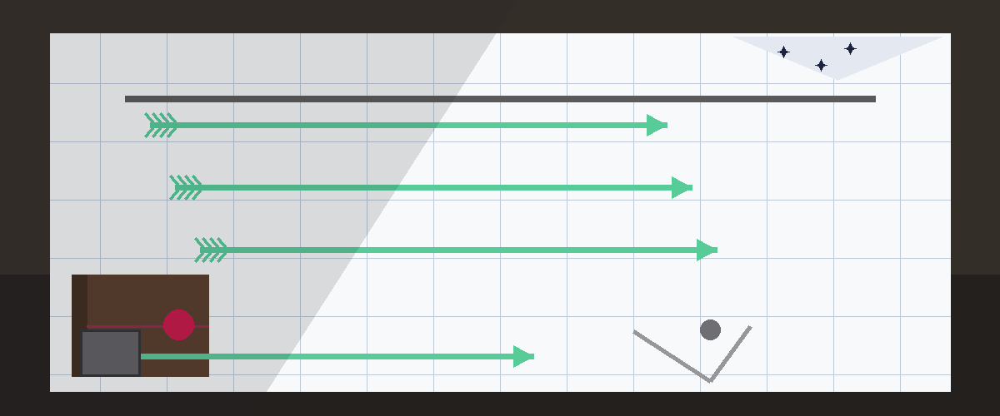
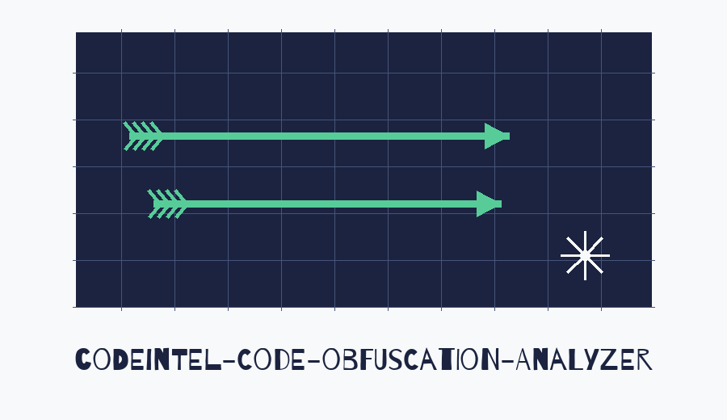

# Code Obfuscation Analyzer

Forecast entry treatment: every heading is set like a forecast entry, date ruled, in Barrio in polar night indigo on star white, with a small vane image beside major headings alone.




A command line wrapper that runs established Python analysis tools over a directory of Python code and logs their output in one place. Despite the repository name, the code contains no obfuscation specific detection of its own: it delegates all analysis to Bandit, Flake8, Pylint and Pyre, which the user selects with flags.

> **Sailing direction note, on the name.** The opening account above keeps its correction at full size: despite the repository name, the code contains no obfuscation specific detection of its own. That honesty stands as printed.


## Requirements

- Python 3 (main.py uses only the standard library)
- At least one of the external tools you plan to run: Bandit, Flake8, Pylint, Pyre (installed by `pip install -r requirements.txt`, or individually)

> **Sailing direction note, on the directory.** The directory entry in the account below is required and positional, and the program exits with status 1 if it does not exist.


## Install

```
git clone https://github.com/ShadowGuard-AI/codeintel-code-obfuscation-analyzer.git
cd codeintel-code-obfuscation-analyzer
pip install -r requirements.txt
```

> **Sailing direction note, on the steps aboard.** The three install steps above stand exactly as printed, with the correct ShadowGuard-AI clone address. No identity fault was found in this README.


## Usage

```
python main.py <directory> [--bandit] [--flake8] [--pylint] [--pyre]
python main.py --help
python main.py --version
```

- `directory` (required, positional): directory containing the code to analyze. The program exits with status 1 if it does not exist.
- `--bandit`: run `bandit -r <directory>`
- `--flake8`: run `flake8 <directory>`
- `--pylint`: run `pylint <directory>`
- `--pyre`: run `pyre check` with the target directory as the working directory. Pyre needs its own project configuration in that directory.
- `--version`: print `main.py 1.0.0` and exit

If no tool flag is given, the program warns that no analysis tools were selected and exits with status 0 without analyzing anything.

> **Sailing direction note, on the empty selection.** If no tool flag is given, the program warns that no analysis tools were selected and exits with status 0 without analysing anything. That behaviour stands in the preserved account above.


## Example

```
python main.py /path/to/code --bandit --flake8
```

Verified behavior on a sample file that passes user input to `os.system`: Bandit findings (including B605, start process with a shell) are printed in the log output, and the program then continues and exits with status 0.

> **Sailing direction note, on the tool not found error.** A selected tool that is not installed produces an error naming the tool, for example Tool not found: bandit is not installed or not on PATH, as the preserved account below states.


## Output and limitations

- Results are written to the log output (stdout and stderr) only. The tool does not write a report file.
- Bandit, Flake8 and Pylint exit with a non-zero status when they find issues. This wrapper logs that status and continues with the remaining tools instead of aborting. It exits with status 0 when every selected tool could be started, and status 1 when the directory does not exist or a selected tool is not installed or not on PATH.
- A selected tool that is not installed produces an error naming the tool, for example `Tool not found: bandit is not installed or not on PATH`, and the program exits with status 1.
- What each tool reports is entirely determined by that tool. This wrapper adds no checks, scoring or deobfuscation of its own.


## License

See LICENSE in this repository.
